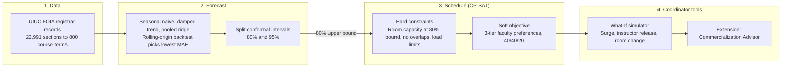
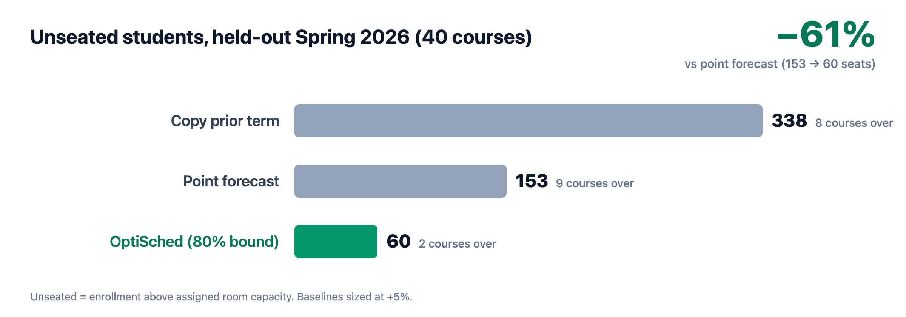
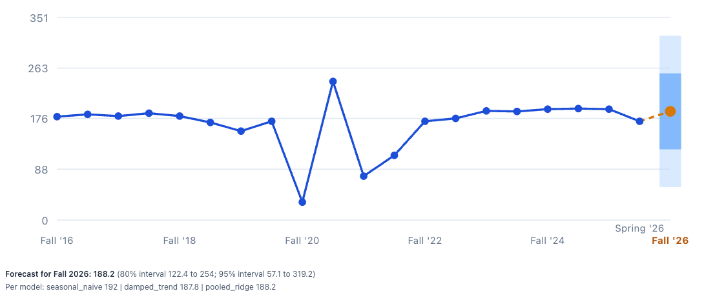
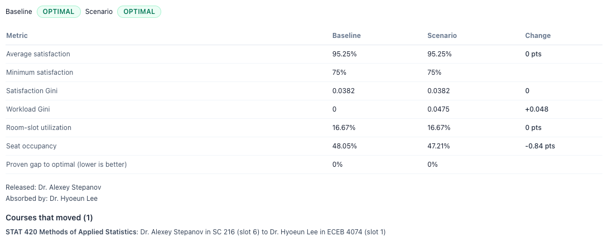
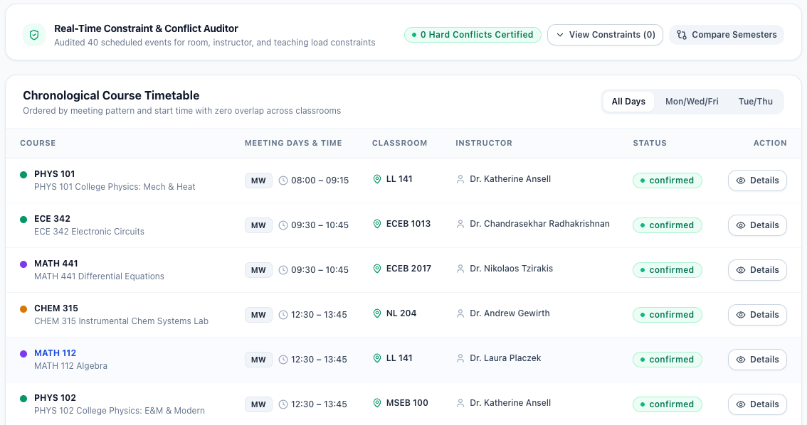

# OptiSched: Uncertainty-Aware Enrollment Forecasting with CP-SAT Course Scheduling
### CS 5551 Advanced Software Engineering · Hack-A-Roo 2026 · UMKC School of Science and Engineering
**Team:** Joe Doan, Tony Nguyen, Tina Nguyen, Salvatore Nigro · **Advisor:** Prof. Yugyung Lee

[](https://www.python.org/downloads/)
[](https://developers.google.com/optimization/cp/cp_solver)
[]()

**Hack-A-Roo deliverables.** [Poster (PDF)](docs/hackathon/OptiSched_HackARoo_Poster.pdf) · [3-minute demo script](docs/hackathon/demo_script.md) · [One-page brief](docs/hackathon/prof_lee_handout.md)

---

## Table of Contents
1. [Overview](#1-overview)
2. [Key Contributions](#2-key-contributions)
3. [System Architecture](#3-system-architecture)
4. [Results on Held-Out Spring 2026](#4-results-on-held-out-spring-2026)
5. [Data and Evaluation](#5-data-and-evaluation)
6. [Application Screenshots](#6-application-screenshots)
7. [Running the Demo](#7-running-the-demo)
8. [Mathematical Model & 3-Tier CP-SAT Formulation](#8-mathematical-model--3-tier-cp-sat-formulation)
9. [Extension Feature: Faculty Commercialization & Policy Retrieval Advisor](#9-extension-feature-faculty-commercialization--policy-retrieval-advisor)
10. [Installation, CLI Usage & Automated Verification Suites](#10-installation-cli-usage--automated-verification-suites)

---

## 1. Overview

Rooms are assigned before registration opens. When a room is sized to last term's headcount or to a single forecast, students go without seats whenever demand runs high.

OptiSched forecasts next-term enrollment for each course and attaches calibrated 80% and 95% prediction intervals (split conformal prediction). Each room is sized to the 80% upper bound. A Google OR-Tools CP-SAT model then assigns rooms, time slots and instructors with zero hard conflicts while scoring faculty preferences.

---

## 2. Key Contributions

- Next-term enrollment forecasts with split-conformal prediction intervals, trained on 19 terms of real registrar data (Fall 2016 to Fall 2025).
- Room sizes taken from the interval and passed directly into a CP-SAT timetable model.
- Held-out evaluation on a real term (Spring 2026, 40 courses) against two baselines.
- A 3-tier faculty preference hierarchy: per-course overrides, general availability, and 2-year teaching history.
- What-If re-solves for enrollment surges, instructor release and room changes, with minimal schedule change.

---

## 3. System Architecture



Stack: FastAPI · OR-Tools CP-SAT · React + TypeScript.

---

## 4. Results on Held-Out Spring 2026



| Metric (40 courses) | Copy prior term (+5%) | Point forecast (+5%) | OptiSched 80% bound |
|:---|:---:|:---:|:---:|
| Forecast MAE (seats) | 28.25 | 17.24 | 17.24 |
| Interval coverage | | | 85% (34/40) at 80%, 97.5% (39/40) at 95% |
| Overflowed courses | 8 | 9 | **2** |
| Unseated students | 338 | 153 | **60** |
| Hard conflicts | 0 | 0 | **0** |

- Unseated students fall 61% against the point forecast and 82% against copying the prior term.
- Seat utilization is 64.9%, against 64.5% in the actual UIUC schedule. Larger rooms did not buy the result.
- Midday (10am to 2pm) concentration is 22.5%, against 47.9% in the actual UIUC schedule.
- On the 25 courses with a teaching history, 84% (21/25) keep the instructor's usual days and slot.

**Who benefits.** Students face fewer first-week seat shortages in high-demand courses. Administrators make fewer room changes after registration, with no loss in seat utilization.

All values are computed by [`foia_replay_service.py`](backend/app/services/foia_replay_service.py) and served at `GET /api/v1/forecast/empirical-benchmark`.

---

## 5. Data and Evaluation

| Input | Source | Real or simulated |
|:---|:---|:---|
| Course enrollment, 800 course-terms | 22,991 UIUC Course Explorer sections (FOIA), 40 STEM courses, Fall 2016 to Spring 2026 | Real |
| Training window | 19 terms, Fall 2016 to Fall 2025 | Real |
| Forecast target | Next term (Spring 2026, held out) | Real |
| Instructor teaching history | Most frequent days and slot per instructor and course over the prior 2 years | Real |
| Room pool (16 rooms) | Fixed testbed for the solver | Simulated |
| Preference weights | 40% day, 40% slot, 20% room | Team-set |
| What-If scenarios | Surge, instructor release, room capacity change | Simulated |

**Definitions.** Unseated students = enrollment above the assigned room's capacity, summed over courses. Baselines are sized at 5% above their estimate.

---

## 6. Application Screenshots

**Demand forecast.** STAT 400 enrollment from Fall 2016 to Spring 2026, with the next-term forecast and its 80% and 95% intervals.



**What-If simulator.** One-click scenarios and the result of the instructor-unavailable preset. One course moved and every other course kept its placement.




**Master schedule.** 40 sections, with the constraint auditor reporting 0 hard conflicts.



---

## 7. Running the Demo

Prerequisites: Python 3.12+, Node.js 20+.

1. Backend on port 8000.
   ```bash
   cd backend
   python3 -m venv venv
   source venv/bin/activate
   pip install -r requirements.txt
   python3 -m uvicorn app.main:app --reload --port 8000
   ```
2. Frontend on port 5173.
   ```bash
   cd frontend
   npm install
   npm run dev
   ```
3. Walk through the workflow at `http://localhost:5173`.
   - Sign in with **Demo Coordinator Login**.
   - **Insights → Demand Forecast** shows the forecast, the Spring 2026 benchmark and the unseated-students chart.
   - **Insights → What-If Simulator** has three one-click scenarios. Pick one and click **Run simulation**.
     1. Enrollment surge (CS +20%, STAT +15%).
     2. Instructor unavailable (one-course grant release, colleague coverage).
     3. Room reassigned (all capacities × 0.9).
   - **Master Schedule** (`/schedule`) shows room, slot and instructor assignments.

## 8. Mathematical Model & 3-Tier CP-SAT Formulation

### Decision Variables
The scheduling domain is pruned using domain preprocessing (`get_valid_ic_pairs()` and `get_valid_rc_pairs()`) to reduce the search space by **>70%**:

| Variable | Indices | Definition |
|:---|:---|:---|
| $X[d, r, s, i, c]$ | $\text{Day} \times \text{Room} \times \text{Slot} \times \text{Inst} \times \text{Course}$ | Binary variable: Course $c$ is taught by instructor $i$ in classroom $r$ at slot $s$ on day $d$. |
| $Y[r, s, i, c]$ | $\text{Room} \times \text{Slot} \times \text{Inst} \times \text{Course}$ | Aggregation variable: Course $c$ meets in room $r$ at slot $s$ under instructor $i$. |
| $Z[i, c]$ | $\text{Inst} \times \text{Course}$ | Assignment variable: Instructor $i$ is assigned to teach course $c$. |

### Hard Constraints
1. **Course Coverage**: Every course must be scheduled exactly once:
   $$\forall c \in \text{Courses}: \quad \sum_{i \in \text{Instructors}} Z[i, c] = 1$$
2. **Teaching Load Upper Bound (Max 2 Classes/Semester)**:
   $$\forall i \in \text{Instructors}: \quad \sum_{c \in \text{Courses}} Z[i, c] \le 2$$
3. **Qualification Purity**: An instructor can only be assigned to courses for which they are explicitly qualified:
   $$\forall (i, c) \notin \text{ValidIC}: \quad Z[i, c] = 0$$
4. **Conformal Room Capacity Compliance**: A course cannot be scheduled in a classroom whose capacity is smaller than its target demand bound $\hat{D}_c^{(1-\alpha)}$:
   $$\forall (r, c) \text{ where } \text{Capacity}(r) < \hat{D}_c^{(1-\alpha)}: \quad \sum_{s, i} Y[r, s, i, c] = 0$$
5. **Laboratory Layout Enforcement**: Laboratory courses must be assigned exclusively to rooms with `layout_type == "lab"`:
   $$\forall c \text{ where } \text{Layout}(c) = \text{lab}, \; \forall r \text{ where } \text{Layout}(r) \ne \text{lab}: \quad \sum_{s, i} Y[r, s, i, c] = 0$$
6. **Classroom & Instructor Single-Occupancy (Zero Double-Booking)**:
   $$\forall d, r, s: \sum_{i, c} X[d, r, s, i, c] \le 1 \qquad \text{and} \qquad \forall d, i, s: \sum_{r, c} X[d, r, s, i, c] \le 1$$
7. **Standard 2-Day Meeting Pattern**: Every course meets on either Monday/Wednesday or Tuesday/Thursday.

### 3-Tier Soft Preference Objective & Dynamic Priority Carryover
For each instructor-course pair $(i, c)$, OptiSched resolves preferences using strict 3-tier precedence:
1. **Tier 1 (Per-Course Override):** Explicit day/slot/room request for course $c$ in the target term.
2. **Tier 2 (General Semester Availability):** Instructor $i$'s default semester preference when no course-specific override is set.
3. **Tier 3 (2-Year Causal Habit):** Modal day/slot/room assignment observed for $(i, c)$ over the prior 4 semesters (`84.0%` continuity on Spring 2026 holdout).

Each candidate assignment is scored out of 10 integer points (**40% Preferred Meeting Days**, **40% Preferred Time Slot**, **20% Preferred Room/Layout**) and weighted by the instructor's dynamic priority score:
$$\max \sum_{i \in \text{Instructors}} \left( \text{Priority}(i) + \text{Jitter}(i) \right) \times \text{SatisfactionScore}(i)$$

---

## 9. Extension Feature: Faculty Commercialization & Policy Retrieval Advisor

As an extension module connected to the scheduling engine (`/commercialization`), OptiSched assists faculty who secure research grants or invention disclosures:
1. **Paper-to-UM-16C Disclosure Drafter:** Extracts a 26-field draft of the University of Missouri System **UM-16C** invention disclosure form from an uploaded research paper PDF in memory (`backend/app/services/idf_service.py`).
2. **BM25 Policy Retrieval & Compliance Checklist:** Indexes **425 passages across 7 UM System and UMKC policy documents** using **BM25 keyword retrieval** (`backend/app/services/policy_service.py`) and generates a conflict-of-interest compliance checklist (`backend/app/services/coi_checklist_service.py`).
3. **One-Click CP-SAT Course-Release Simulation:** Connects directly to the **What-If Simulator** (`backend/app/services/scenario_service.py`) so department chairs can verify whether the timetable can absorb a faculty member's grant-funded course buyout before approving the release.

---

## 10. Installation, CLI Usage & Automated Verification Suites

### Repository Structure
```text
Scheduler_project/
├── backend/
│   ├── app/
│   │   ├── api/v1/                            # REST Controllers (schedules, insights, commercialization)
│   │   ├── services/
│   │   │   ├── forecast_service.py            # Pooled Ridge + Split Conformal Prediction Engine
│   │   │   ├── foia_replay_service.py         # UIUC FOIA held-out Spring 2026 benchmark
│   │   │   ├── scenario_service.py            # Counterfactual What-If CP-SAT Re-Solver
│   │   │   └── policy_service.py              # BM25 Policy Retrieval (425 Passages, 7 Docs)
│   │   └── solver/                            # 3-Tier Google OR-Tools CP-SAT Engine
│   ├── data/
│   │   ├── uiuc_foia/                         # UIUC FOIA dataset (800 course-terms)
│   │   └── umkc/                              # 6-Term UMKC Department Simulation Dataset
│   └── tests/                                 # 196 Automated Backend Pytest Cases
├── frontend/
│   └── src/                                   # React + TypeScript UI (157 Vitest Cases across 33 Suites)
└── docs/
    ├── hackathon/
    │   ├── OptiSched_HackARoo_Poster.pdf      # 1-Page Visual Hack-A-Roo Poster
    │   ├── demo_script.md                     # Timed 3:00 Video Demonstration Script
    │   └── prof_lee_handout.md                # 1-Page Executive Brief
    └── images/                                # Benchmark Charts & Live Application Screenshots
```

### Automated Test Suites (`196` Backend Pytest + `157` Frontend Vitest)

1. **Run the Full Backend Pytest Suite (`196 passed`):**
   ```bash
   cd backend
   python3 -m pytest -q
   ```

2. **Run the UIUC FOIA held-out benchmark suite:**
   ```bash
   cd backend
   python3 -m pytest tests/test_uiuc_foia_replay.py -q
   ```

3. **Run the Full Frontend Vitest Suite (`33 test files, 157 passed`):**
   ```bash
   cd frontend
   npx vitest run
   ```

4. **Regenerate the Visual Comparison Chart & 1-Page Poster PDF:**
   ```bash
   python3 docs/hackathon/generate_poster_and_chart.py
   ```

---

## Team & Acknowledgments
- **Course**: CS 5551 — Advanced Software Engineering & Hack-A-Roo 2026
- **Institution**: University of Missouri-Kansas City (UMKC) — School of Science & Engineering (SSE)
- **Faculty Advisor**: Prof. Yugyung Lee
- **Core Engine**: Split Conformal Prediction + Google OR-Tools CP-SAT
