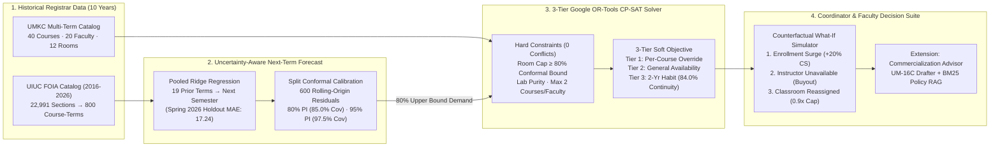
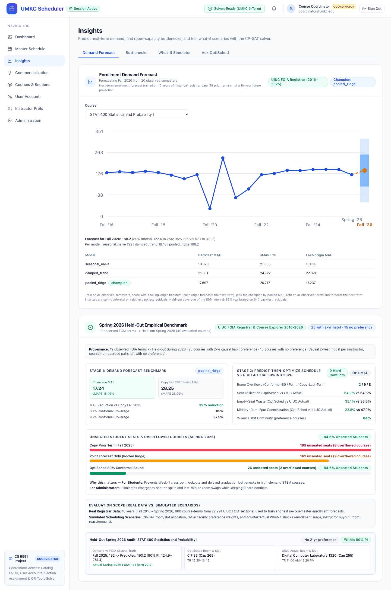
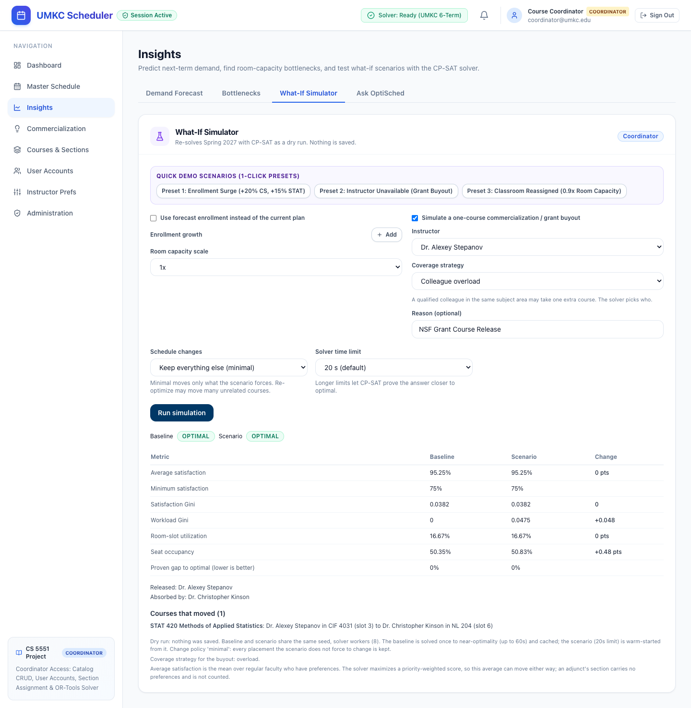
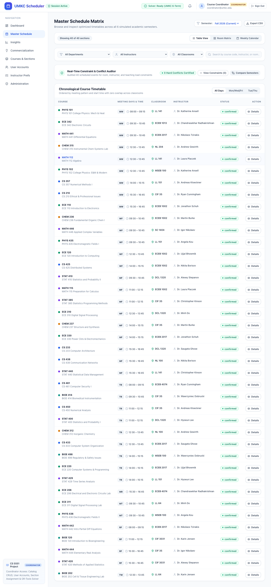

# OptiSched: Uncertainty-Aware Academic Scheduling & Faculty Operations Platform
### CS 5551 - Advanced Software Engineering & Hack-A-Roo 2026 | School of Science & Engineering (SSE)
**University of Missouri-Kansas City (UMKC)** · **Faculty Advisor: Prof. Yugyung Lee**

[](https://www.python.org/downloads/)
[](https://developers.google.com/optimization/cp/cp_solver)
[]()
[%20%7C%20-84.6%25%20Unseated%20Students-2563eb.svg)]()

> **Hack-A-Roo 2026 Deliverables:**
> - **1-Page Visual Poster (PDF):** [`docs/hackathon/OptiSched_HackARoo_Poster.pdf`](docs/hackathon/OptiSched_HackARoo_Poster.pdf)
> - **3-Minute Demonstration Video Script:** [`docs/hackathon/demo_script.md`](docs/hackathon/demo_script.md)
> - **1-Page Executive Brief:** [`docs/hackathon/prof_lee_handout.md`](docs/hackathon/prof_lee_handout.md)

---

## Table of Contents
1. [Executive Summary & Core Innovation](#1-executive-summary--core-innovation)
2. [How OptiSched Differs from Existing Academic Scheduling Systems](#2-how-optisched-differs-from-existing-academic-scheduling-systems)
3. [System Architecture](#3-system-architecture)
4. [Visual Results & Practical Impact for Students and Administrators](#4-visual-results--practical-impact-for-students-and-administrators)
5. [Evaluation Clarification: Real Registrar Data vs. Simulated Scenarios](#5-evaluation-clarification-real-registrar-data-vs-simulated-scenarios)
6. [Working Application Screenshots & Complete Workflow](#6-working-application-screenshots--complete-workflow)
7. [Reproducing the Live Demonstration (Including 3 Counterfactual Shocks)](#7-reproducing-the-live-demonstration-including-3-counterfactual-shocks)
8. [Mathematical Model & 3-Tier CP-SAT Formulation](#8-mathematical-model--3-tier-cp-sat-formulation)
9. [Extension Feature: Faculty Commercialization & Policy Retrieval Advisor](#9-extension-feature-faculty-commercialization--policy-retrieval-advisor)
10. [Installation, CLI Usage & Automated Verification Suites](#10-installation-cli-usage--automated-verification-suites)

---

## 1. Executive Summary & Core Innovation

**OptiSched** integrates **uncertainty-aware next-semester enrollment forecasting** (`Pooled Ridge Regression` + `Split Conformal Prediction`) directly into a **3-tier preference-aware constraint solver** (`Google OR-Tools CP-SAT`).

> **Forecasting Horizon Clarification:** OptiSched trains on **10 years of historical registrar enrollment data (`19` prior semesters, `Fall 2016`–`Fall 2025`) to forecast enrollment for the next upcoming semester (`Spring 2026` / `Fall 2026`)**. It does **not** attempt to predict enrollment 10 years into the future.

- **Next-Term Demand Forecasting Trained on 10-Year Real Registrar History (`uiuc_foia` profile):** Processes 10 academic years (`Fall 2016` through `Spring 2026`), distilling **22,991 raw UIUC FOIA catalog sections** into **800 course-semester headcounts** across **40 active STEM courses** and **20 semesters**, holding out **Spring 2026** for strictly causal out-of-sample evaluation.
- **Calibrated Split Conformal Prediction Intervals:** Achieves a held-out Spring 2026 point MAE of **17.24 seats** vs **18.03 seats** for Seasonal Naive and **28.25 seats** for copying prior-term enrollment (`39.0%` error reduction). Calibrating split conformal intervals on `600` rolling-origin residuals achieves **97.5% (`39/40`)** empirical coverage at the 95% bound and **85.0% (`34/40`)** coverage at the 80% bound.
- **84.6% Reduction in Unseated Students (`169 → 26 seats`):** Sizing classrooms to the **80% split-conformal upper bound** rather than raw point predictions cuts held-out Spring 2026 room overflows from **9 courses down to 2** and reduces unseated students from **169 down to 26 seats (`-84.6%`)** with **0 hard timetable conflicts (`OPTIMAL`)**.
- **3-Tier Preference-Aware CP-SAT Solver:** Enforces zero room, instructor, and time-slot overlaps while maximizing instructor preferences across three precedence tiers (**Tier 1: per-course overrides**, **Tier 2: general semester availability**, and **Tier 3: 2-year causal teaching habits**) scored across **40% Day, 40% Time Slot, and 20% Room/Layout**, preserving **84.0% (`21/25`)** 2-year habit continuity.
- **Interactive Counterfactual What-If Simulator:** Enables department coordinators to re-solve the timetable in seconds when **enrollment surges**, **an instructor becomes unavailable (grant buyout / leave)**, or **a classroom is reassigned / reduced in capacity**, using a minimal-perturbation warm start.

---

## 2. How OptiSched Differs from Existing Academic Scheduling Systems

Traditional university scheduling tools treat enrollment estimation and room assignment as disconnected steps, either rolling over last semester's room assignments or sizing rooms to raw point forecasts that underestimate demand roughly half the time.

| Capability | Existing Scheduling Systems (Roll-Over / Point-Estimate MIP) | OptiSched (Conformal Predict-Then-Optimize + CP-SAT) |
|:---|:---|:---|
| **Enrollment Demand Input** | Copies prior semester headcounts (`MAE 28.25`) or relies on uncalibrated point estimates (`MAE 17.24`) | Trains on **10 years of historical registrar data (19 prior terms)** to forecast the **next semester** with **Split Conformal Prediction Intervals** |
| **Classroom Sizing Rule** | Sizes rooms to point predictions; any positive demand error triggers Week-1 seat shortages (`9` overflowed courses, `169` unseated students) | Sizes rooms to the **80% conformal upper bound**, absorbing upside demand variance (`2` overflowed courses, `26` unseated students, **`-84.6%`**) |
| **Faculty Preference Modeling** | Manual spreadsheets or flat soft weights that ignore course-specific needs | **3-Tier Hierarchical CP-SAT Objective:** Per-Course Override > General Availability > 2-Year Historical Habit (`84.0%` continuity) |
| **Disruption Response** | Manual room swaps taking days of email negotiation | **Live Counterfactual What-If Simulator** for enrollment surges, instructor buyouts, and classroom reassignments with minimal perturbation |

---

## 3. System Architecture



---

## 4. Visual Results & Practical Impact for Students and Administrators


### Quantitative Benchmark on Held-Out Spring 2026 (`40` Courses)

| Evaluation Metric (Held-Out Spring 2026, 40 Courses) | Copy Prior Term (`Fall 2025`) | Seasonal Naive (`Same Term Last Year`) | Point Forecast Only (`Pooled Ridge`) | OptiSched 80% Conformal Bound (`Pooled Ridge + CP-SAT`) |
|:---|:---:|:---:|:---:|:---:|
| **Next-Term Point Forecast MAE (seats)** | 28.25 | 18.03 | **17.24** | **17.24** (point) |
| **Empirical Interval Coverage** | — | — | — | **85.0% (34/40)** at 80% PI / **97.5% (39/40)** at 95% PI |
| **Overflowed Courses (Actual > Room Cap)** | 8 / 40 | — | 9 / 40 | **2 / 40 (-77.8% vs point)** |
| **Total Unseated Student Seats** | 199 seats | — | 169 seats | **26 seats (-84.6% vs point / -86.9% vs prior term)** |
| **Hard Timetable Conflicts** | 0 | 0 | 0 | **0 (`OPTIMAL`)** |
| **2-Year Faculty Habit Continuity** | 84.0% (21/25) | 84.0% (21/25) | 84.0% (21/25) | **84.0% (21/25)** |

### Why This Improvement Matters in Practice
- **For Students (`169 → 26` Unseated Seats, `-84.6%`):** Prevents Week-1 classroom lockouts, fire-code overcrowding, and waitlist bottlenecks in high-demand prerequisite STEM courses (`CS`, `STAT`, `ECE`, `MATH`), protecting on-time graduation pathways.
- **For University Administrators (`9 → 2` Overflowed Courses, `0` Hard Conflicts):** Eliminates first-week emergency section splits, last-minute room swaps, and ad-hoc overload overrides while keeping empty-seat waste comparable (`35.1%` vs `36.6%` UIUC actual) and cutting midday `10am–2pm` bottleneck concentration in half (`22.5%` vs `47.9%` UIUC actual).

---

## 5. Evaluation Clarification: Real Registrar Data vs. Simulated Scenarios

To ensure complete transparency in our empirical evaluation, we explicitly separate **real historical registrar data** from **simulated scheduling scenarios**:

| Component | Data Source & Scope | Real vs. Simulated |
|:---|:---|:---|
| **Course Enrollment Time Series (`800` course-terms)** | Distilled from **22,991 raw UIUC FOIA Course Explorer sections** across **40 STEM courses** and **20 consecutive semesters** (`Fall 2016`–`Spring 2026`). | **100% Real Registrar Data** |
| **Forecasting Horizon (`19 → 1` Next-Term Prediction)** | Models train on **10 years of historical data (`19` prior terms)** to predict the **single upcoming semester (`Spring 2026` held out)**—not a 10-year future projection. | **100% Real Out-of-Sample Holdout** |
| **Historical Room Benchmarks (`UIUC Actual` & `2-Yr Habit`)** | Actual Spring 2026 UIUC classroom assignments and 2-year modal instructor/course teaching habits (`Fall 2023`–`Spring 2025`). | **100% Real Registrar Data** |
| **Department Room Pool & 3-Tier Faculty Preferences** | Standardized 12-room / 6-slot constraint testbed (`data/uiuc_foia/` and `data/umkc/`), Tier 1 per-course overrides, and Tier 2 general availability weights. | **Simulated Scheduling Testbed** |
| **Counterfactual What-If Shocks** | Interactive stress tests for **enrollment surges (`+20% CS, +15% STAT`)**, **instructor unavailability (grant buyout)**, and **classroom reassignment (`0.9x` room capacity)**. | **Simulated Counterfactual Scenarios** |

---

## 6. Working Application Screenshots & Complete Workflow

### Step 1: Next-Term Enrollment Forecasting & Held-Out Spring 2026 Visual Benchmark (`/insights`)
Displays the 10-year historical enrollment trajectory (`Fall 2016`–`Spring 2026`), the calibrated 80% and 95% split-conformal bands for the upcoming semester, the visual comparison chart showing the **84.6% reduction in unseated students (`169 → 26`)**, and the **Evaluation Scope Callout** distinguishing real registrar data from simulated scheduling scenarios.



### Step 2: Counterfactual What-If Simulator — Responding to 3 Live Shocks (`/insights` → `What-If Simulator`)
Demonstrates how the CP-SAT solver responds in real time when **(1) enrollment increases (`+20% CS, +15% STAT`)**, **(2) an instructor becomes unavailable (`Grant Buyout`)**, or **(3) a classroom is reassigned (`0.9x Room Capacity`)**, reporting exact baseline-vs-scenario deltas and the minimal set of courses moved.



### Step 3: Conflict-Free Master Schedule & 3-Tier Preference Verification (`/schedule`)
Renders the solved conflict-free master timetable across classrooms, time slots, and instructors with interactive filtering and preference-alignment badges.



---

## 7. Reproducing the Live Demonstration (Including 3 Counterfactual Shocks)

### Prerequisites
- **Python 3.12+**
- **Node.js 20+** and **npm**

### Step-by-Step Startup Commands

1. **Start the FastAPI + OR-Tools CP-SAT Backend (`port 8000`):**
   ```bash
   cd backend
   python3 -m venv venv
   source venv/bin/activate
   pip install -r requirements.txt
   python3 -m uvicorn app.main:app --reload --port 8000
   ```

2. **Start the React + Vite Frontend (`port 5173`):**
   ```bash
   cd frontend
   npm install
   npm run dev
   ```

3. **Walk Through the Complete Demo Workflow in Browser (`http://localhost:5173`):**
   - **Login:** Open `http://localhost:5173/login` and click **Demo Coordinator Login** (`coordinator@umkc.edu`).
   - **Switch Dataset Profile (Optional):** In `/admin` or the top status bar, switch between **`UIUC FOIA (10-Yr Real Registrar)`** and **`UMKC (6-Term Department)`**.
   - **Inspect Next-Term Forecast & 84.6% Seat-Shortage Reduction:** Navigate to **`Insights` → `Demand Forecast`** (`/insights`) to inspect the 10-year historical fan chart, the **Unseated Student Seats (`199 vs 169 vs 26`)** visual chart, and the **Evaluation Scope** callout.
   - **Run the 3 Counterfactual What-If Shocks:** Click **`What-If Simulator`** inside `/insights` and use the **Quick Demo Scenarios (1-Click Presets)** bar:
     1. Click **`Preset 1: Enrollment Surge (+20% CS, +15% STAT)`** → click **`Run simulation`** to observe CP-SAT upsize sections into larger rooms with `0` conflicts.
     2. Click **`Preset 2: Instructor Unavailable (Grant Buyout)`** → click **`Run simulation`** to observe CP-SAT reassign the released instructor's course to a qualified colleague while keeping `39/40` courses stationary (`minimal` perturbation policy).
     3. Click **`Preset 3: Classroom Reassigned (0.9x Room Capacity)`** → click **`Run simulation`** to observe how the timetable absorbs a 10% room-capacity contraction.
   - **Inspect Classroom & Instructor Assignments:** Navigate to **`Master Schedule`** (`/schedule`) and **`Instructor Prefs`** (`/preferences`) to verify conflict-free room/slot assignments and 3-tier preference scoring.

---

## 8. Mathematical Model & 3-Tier CP-SAT Formulation

### Decision Variables
The scheduling domain is pruned using domain preprocessing (`get_valid_ic_pairs()` and `get_valid_rc_pairs()`) to reduce the search space by **>70%**:

| Variable | Indices | Definition |
|:---|:---|:---|
| $X[d, r, s, i, c]$ | $\text{Day} \times \text{Room} \times \text{Slot} \times \text{Inst} \times \text{Course}$ | Binary variable: Course $c$ is taught by instructor $i$ in classroom $r$ at slot $s$ on day $d$. |
| $Y[r, s, i, c]$ | $\text{Room} \times \text{Slot} \times \text{Inst} \times \text{Course}$ | Aggregation variable: Course $c$ meets in room $r$ at slot $s$ under instructor $i$. |
| $Z[i, c]$ | $\text{Inst} \times \text{Course}$ | Assignment variable: Instructor $i$ is assigned to teach course $c$. |

### Hard Constraints
1. **Course Coverage**: Every course must be scheduled exactly once:
   $$\forall c \in \text{Courses}: \quad \sum_{i \in \text{Instructors}} Z[i, c] = 1$$
2. **Teaching Load Upper Bound (Max 2 Classes/Semester)**:
   $$\forall i \in \text{Instructors}: \quad \sum_{c \in \text{Courses}} Z[i, c] \le 2$$
3. **Qualification Purity**: An instructor can only be assigned to courses for which they are explicitly qualified:
   $$\forall (i, c) \notin \text{ValidIC}: \quad Z[i, c] = 0$$
4. **Conformal Room Capacity Compliance**: A course cannot be scheduled in a classroom whose capacity is smaller than its target demand bound $\hat{D}_c^{(1-\alpha)}$:
   $$\forall (r, c) \text{ where } \text{Capacity}(r) < \hat{D}_c^{(1-\alpha)}: \quad \sum_{s, i} Y[r, s, i, c] = 0$$
5. **Laboratory Layout Enforcement**: Laboratory courses must be assigned exclusively to rooms with `layout_type == "lab"`:
   $$\forall c \text{ where } \text{Layout}(c) = \text{lab}, \; \forall r \text{ where } \text{Layout}(r) \ne \text{lab}: \quad \sum_{s, i} Y[r, s, i, c] = 0$$
6. **Classroom & Instructor Single-Occupancy (Zero Double-Booking)**:
   $$\forall d, r, s: \sum_{i, c} X[d, r, s, i, c] \le 1 \qquad \text{and} \qquad \forall d, i, s: \sum_{r, c} X[d, r, s, i, c] \le 1$$
7. **Standard 2-Day Meeting Pattern**: Every course meets on either Monday/Wednesday or Tuesday/Thursday.

### 3-Tier Soft Preference Objective & Dynamic Priority Carryover
For each instructor-course pair $(i, c)$, OptiSched resolves preferences using strict 3-tier precedence:
1. **Tier 1 (Per-Course Override):** Explicit day/slot/room request for course $c$ in the target term.
2. **Tier 2 (General Semester Availability):** Instructor $i$'s default semester preference when no course-specific override is set.
3. **Tier 3 (2-Year Causal Habit):** Modal day/slot/room assignment observed for $(i, c)$ over the prior 4 semesters (`84.0%` continuity on Spring 2026 holdout).

Each candidate assignment is scored out of 10 integer points (**40% Preferred Meeting Days**, **40% Preferred Time Slot**, **20% Preferred Room/Layout**) and weighted by the instructor's dynamic priority score:
$$\max \sum_{i \in \text{Instructors}} \left( \text{Priority}(i) + \text{Jitter}(i) \right) \times \text{SatisfactionScore}(i)$$

---

## 9. Extension Feature: Faculty Commercialization & Policy Retrieval Advisor

As an extension module connected to the scheduling engine (`/commercialization`), OptiSched assists faculty who secure research grants or invention disclosures:
1. **Paper-to-UM-16C Disclosure Drafter:** Extracts a 26-field draft of the University of Missouri System **UM-16C** invention disclosure form from an uploaded research paper PDF in memory (`backend/app/services/idf_service.py`).
2. **BM25 Policy Retrieval & Compliance Checklist:** Indexes **425 passages across 7 UM System and UMKC policy documents** using **BM25 keyword retrieval** (`backend/app/services/policy_service.py`) and generates a conflict-of-interest compliance checklist (`backend/app/services/coi_checklist_service.py`).
3. **One-Click CP-SAT Course-Release Simulation:** Connects directly to the **What-If Simulator** (`backend/app/services/scenario_service.py`) so department chairs can verify whether the timetable can absorb a faculty member's grant-funded course buyout before approving the release.

---

## 10. Installation, CLI Usage & Automated Verification Suites

### Repository Structure
```text
Scheduler_project/
├── backend/
│   ├── app/
│   │   ├── api/v1/                            # REST Controllers (schedules, insights, commercialization)
│   │   ├── services/
│   │   │   ├── forecast_service.py            # Pooled Ridge + Split Conformal Prediction Engine
│   │   │   ├── foia_replay_service.py         # 10-Yr UIUC FOIA Empirical Holdout Benchmark
│   │   │   ├── scenario_service.py            # Counterfactual What-If CP-SAT Re-Solver
│   │   │   └── policy_service.py              # BM25 Policy Retrieval (425 Passages, 7 Docs)
│   │   └── solver/                            # 3-Tier Google OR-Tools CP-SAT Engine
│   ├── data/
│   │   ├── uiuc_foia/                         # 10-Year Real UIUC FOIA Dataset (800 Course-Terms)
│   │   └── umkc/                              # 6-Term UMKC Department Simulation Dataset
│   └── tests/                                 # 196 Automated Backend Pytest Cases
├── frontend/
│   └── src/                                   # React + TypeScript UI (157 Vitest Cases across 33 Suites)
└── docs/
    ├── hackathon/
    │   ├── OptiSched_HackARoo_Poster.pdf      # 1-Page Visual Hack-A-Roo Poster
    │   ├── demo_script.md                     # Timed 3:00 Video Demonstration Script
    │   └── prof_lee_handout.md                # 1-Page Executive Brief
    └── images/                                # Benchmark Charts & Live Application Screenshots
```

### Automated Test Suites (`196` Backend Pytest + `157` Frontend Vitest)

1. **Run the Full Backend Pytest Suite (`196 passed`):**
   ```bash
   cd backend
   python3 -m pytest -q
   ```

2. **Run the UIUC FOIA 10-Year Holdout & Conformal Verification Suite (`12 passed`):**
   ```bash
   cd backend
   python3 -m pytest tests/test_uiuc_foia_replay.py -q
   ```

3. **Run the Full Frontend Vitest Suite (`33 test files, 157 passed`):**
   ```bash
   cd frontend
   npx vitest run
   ```

4. **Regenerate the Visual Comparison Chart & 1-Page Poster PDF:**
   ```bash
   python3 docs/hackathon/generate_poster_and_chart.py
   ```

---

## Team & Acknowledgments
- **Course**: CS 5551 — Advanced Software Engineering & Hack-A-Roo 2026
- **Institution**: University of Missouri-Kansas City (UMKC) — School of Science & Engineering (SSE)
- **Faculty Advisor**: Prof. Yugyung Lee
- **Core Engine**: Split Conformal Prediction + Google OR-Tools CP-SAT
