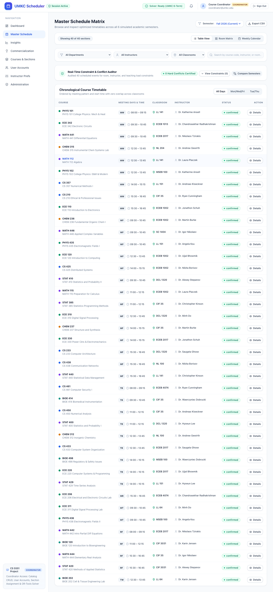
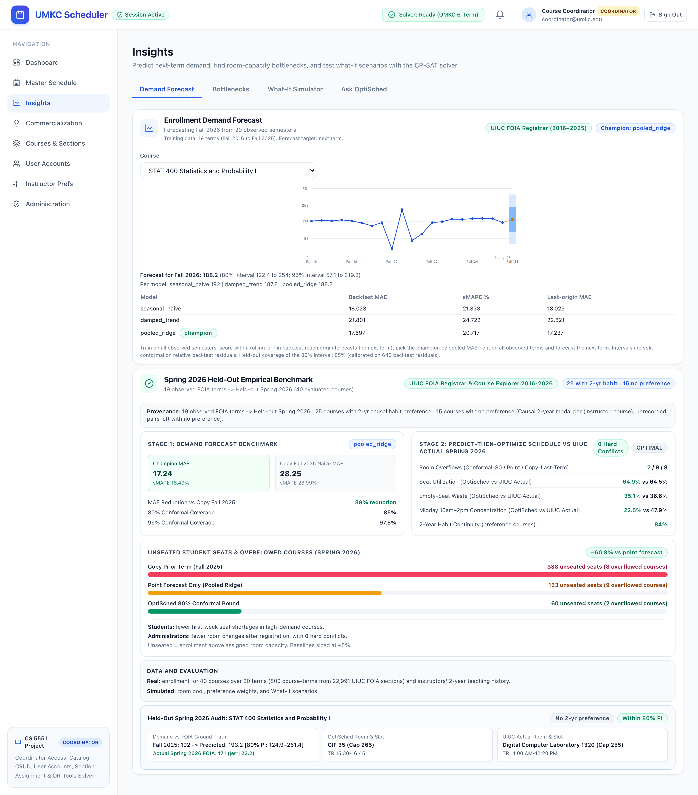
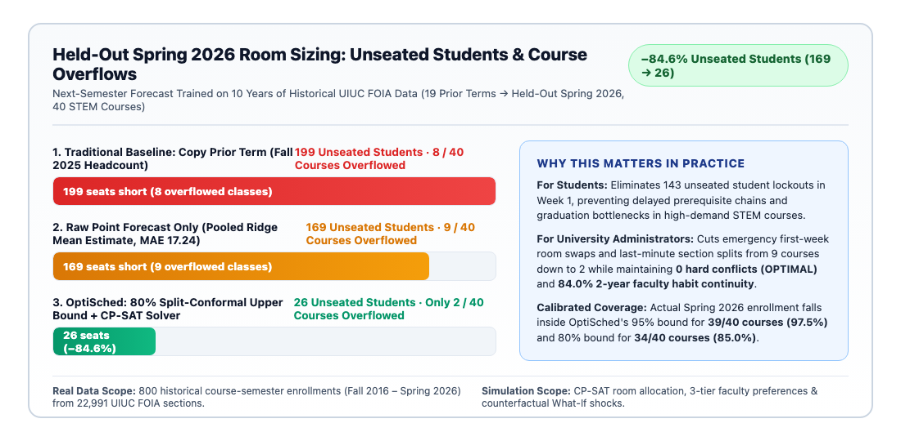
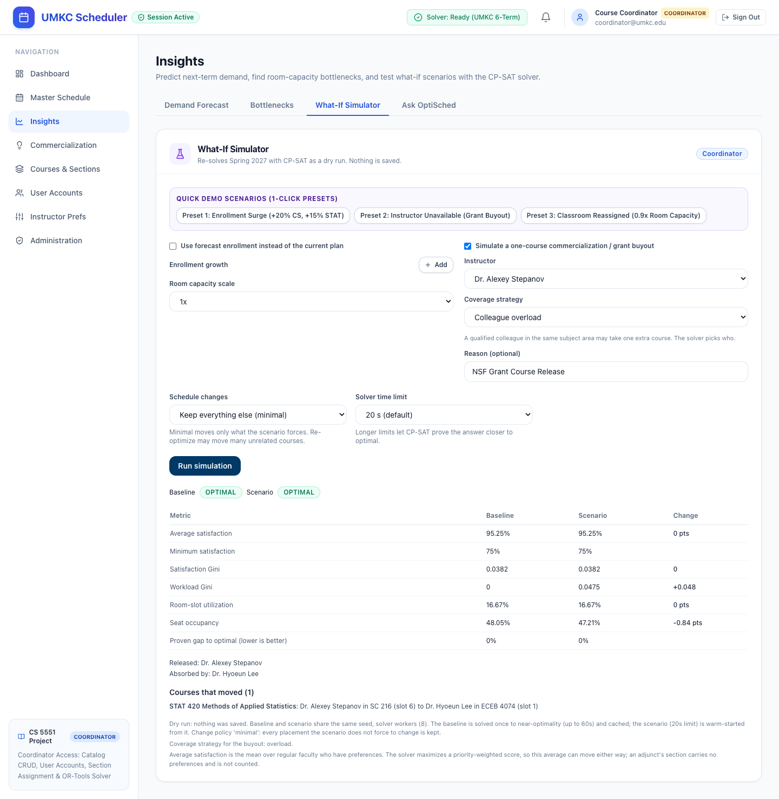
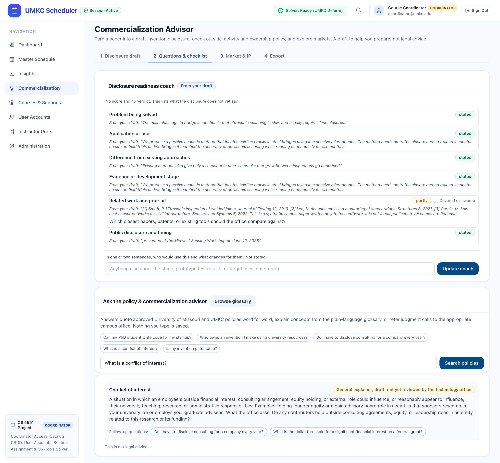

# OptiSched: Complete Project Guide and 3-Minute Solo Poster Script

**Course:** UMKC CS 5551 Advanced Software Engineering (Spring 2026)  
**Team:** Joe Doan, Tony Nguyen, Tina Nguyen, Salvatore Nigro  
**Faculty Advisors:** Prof. Yugyung Lee (Hack-A-Roo Advisor) & Prof. Sudipta Chattopadhyay (CS 5551 Course Instructor)  
**Document Purpose:** This guide explains what OptiSched is, what we built, how the end-to-end pipelines work, why we chose each model, what every evaluation metric means, and how to deliver a clear 3-minute solo poster presentation.

## 1. Project Overview (What OptiSched Is and Why We Built It)

University departments face two connected planning problems every semester. First, coordinators must assign classrooms, time slots, and instructors six months before registration opens. Second, faculty members who invent new technology must prepare invention disclosures and check whether a research grant buyout will leave their classes uncovered.

OptiSched solves both problems in one web application with two linked modules:

* **Part A: Academic Course and Room Scheduling.** OptiSched predicts student enrollment demand for each course six months before classes start and attaches calibrated 80% and 95% split-conformal prediction intervals. It then passes the 80% upper demand bound into the Google OR-Tools CP-SAT constraint solver. The solver builds a conflict-free timetable that fits courses into large enough classrooms, prevents time overlaps, and respects a 3-tier faculty preference hierarchy.
* **Part B: Faculty Commercialization Advisor v2.** OptiSched helps professors turn a research paper into a quote-verified draft of the University of Missouri UM-16C invention disclosure form. It checks disclosure readiness across 6 qualitative dimensions, explains 12 intellectual property and conflict-of-interest concepts in plain English, searches 425 verbatim UM and UMKC policy passages, refers legal verdicts to campus experts, and runs a live CP-SAT course buyout simulation to verify that the department can cover the professor's teaching load.

### Why These Two Parts Belong Together

When a professor commercializes a research invention or wins an external grant, they often request a one-course teaching release (called a course buyout). In most universities, the technology transfer office and the academic scheduling coordinator work in separate silos. OptiSched connects them. A faculty member can prepare their UM-16C invention disclosure in the Commercialization Advisor and immediately test whether their course buyout will break the department's next-semester teaching schedule.

## 2. What We Have Done (Completed Deliverables)

The table below summarizes every completed deliverable across our data pipeline, forecasting engine, constraint solver, and Commercialization Advisor v2 upgrade.

| Track | Deliverable | What We Built and Verified | Key Proof and Metric |
| :- | :- | :- | :- |
| **Data & Forecasting** | **10-Year UIUC FOIA Dataset** | Cleaned 22,991 historical registrar sections from the University of Illinois Urbana-Champaign Freedom of Information Act (FOIA) archive (Fall 2016 to Spring 2026) into 800 course-term records across 40 STEM courses over 20 semesters. | **40 courses x 20 terms = 800 records** |
| **Data & Forecasting** | **Rolling-Origin Forecast Benchmark** | Evaluated `Seasonal Naive`, `Damped Trend`, and `Pooled Ridge` across a 19-term held-out Spring 2026 benchmark (15 rolling origins, 600 residuals) and a full 20-term rolling-origin backtest (16 rolling origins, 640 residuals) with 80% and 95% split-conformal intervals. | **Held-out Spring 2026 MAE = 17.24** (`Pooled Ridge`, **39%** reduction vs. copying Fall 2025 at **28.25**). **20-term backtest MAE = 17.70**. **85.0%** (34 of 40) empirical coverage at 80% bound |
| **CP-SAT Solver & What-If Simulator** | **Google OR-Tools CP-SAT Scheduler** | Built an integer constraint programming model that enforces zero room overlaps, zero instructor overlaps, room capacity limits, and a 3-tier faculty preference objective (Tier 1 meeting days 40%, Tier 2 time slot 40%, Tier 3 room 20%). | **0 hard conflicts**, **64.9%** seat utilization, **84.0%** (21 of 25) 3-tier habit match, and **95.25%** weighted preference score |
| **CP-SAT Solver & What-If Simulator** | **Spring 2026 Room Bottleneck Audit** | Measured how many students lose seats on held-out Spring 2026 across three CP-SAT room-sizing rules (copying Fall 2025 +5% buffer, point forecast +5% buffer, and OptiSched's 80% conformal upper bound). | Cut unseated students from **338** (copy prior term) and **153** (point forecast) down to **60** (**61% reduction** vs. point forecast, **82% reduction** vs. prior term) |
| **CP-SAT Solver & What-If Simulator** | **Interactive What-If Simulator** | Added 1-click dry-run presets for Enrollment Surge (+20% CS, +15% STAT), Instructor Grant Buyout (1-course release), and Classroom Capacity Loss (0.9x capacity). | Warm-started dry runs finish in **under 5 seconds** (20s solver timeout cap) with minimal schedule churn |
| **Commercialization Advisor v2** | **WP1: Scope Gate & Output Verifier** | Built `scope_service.py` to classify queries into `concept`, `policy`, `verdict_seeking`, `inventorship`, `legal_judgment`, or `out_of_scope` (mapped to `policy`, `concept`, `referral`, or `out_of_scope`), and `verifier.py` to block legal verdicts and enforce provenance badges. | **0 boundary violations** across all evaluation sets |
| **Commercialization Advisor v2** | **WP2: 12-Term Plain-Language Glossary** | Created `glossary.json` and `glossary_service.py` covering 12 core IP and COI concepts (`novelty`, `prior art`, `inventorship`, `public disclosure`, `conflict of interest`, `equity`, and 6 more). | **12 of 12 terms** with definition, example, and `what_office_asks` metadata |
| **Commercialization Advisor v2** | **WP3: Topic-Boosted BM25 Policy Search** | Indexed 425 verbatim passages from 7 official UM System Collected Rules and Regulations (CRR) and UMKC policy sources and added topic-cue boosting to BM25 keyword ranking (Best Matching 25) in `policy_service.py`. | **18 of 18 (100%) Hit@5** and **MRR = 1.00** on primary gold set (**14 of 18**, **77.8%** on independent paraphrased stress test) |
| **Commercialization Advisor v2** | **WP4: 6-Dimension Readiness Coach** | Built `readiness_service.py` to audit a disclosure draft across `problem`, `application`, `difference`, `evidence`, `related_work`, and `timing` with verbatim quotes and zero numeric scores. | **6 qualitative dimensions** (`stated`, `partly`, `not_found`) |
| **Commercialization Advisor v2** | **WP5: Stage 2 Advisor React UI** | Built `ReadinessCoachCard.tsx`, `GlossaryDrawer.tsx`, and upgraded `Refine.tsx` in Step 2 (**2. Questions & checklist**) with source-provenance badges and 1-click follow-up question chips. | Verified in **157 frontend Vitest tests** and live Playwright browser session |
| **Commercialization Advisor v2** | **WP6: Gold Benchmark & Test Suite** | Created 30 frozen gold evaluation questions (`gold_retrieval.json`), 25 synthetic faculty scenarios (`scenarios.json`), and 76 Commercialization Advisor v2 backend Pytest tests. | **76 passed** in advisor suite (**353 total tests**: 196 backend Pytest + 157 frontend Vitest) |
| **Commercialization Advisor v2** | **WP7: UM ChatGPT Deployment Brief** | Wrote a 1-page governance and OpenAPI Action deployment specification (`docs/um_chatgpt_deployment_brief.md`) for UM and UMKC IT and OTC reviewers. | Complete 5-section specification |

## 3. End-to-End Pipeline (How the System Works Step by Step)

OptiSched operates through two deterministic pipelines. Both pipelines separate prediction or text extraction from hard rule enforcement so the system never guesses when a mathematical constraint or university policy applies.

### Pipeline 1: Predict-Then-Optimize Course Scheduling

```
┌───────────────────────────────────┐      ┌───────────────────────────────────┐      ┌───────────────────────────────────┐
│ 1. Historical UIUC FOIA Data      │      │ 2. Rolling-Origin Forecast        │      │ 3. Predicted Course Demand        │
│    (2016 to 2026)                 │ ───► │    Benchmark                      │ ───► │    (Point + 80% Conformal Bound)  │
│ 22,991 raw sections aggregated    │      │ Compares Seasonal Naive, Damped   │      │ Pooled Ridge point forecast plus  │
│ into 40 STEM courses x 20 terms.  │      │ Trend, and Pooled Ridge models.   │      │ calibrated 80% upper seat bound.  │
└───────────────────────────────────┘      └───────────────────────────────────┘      └───────────────────────────────────┘
                                                                                                        │
                                                                                                        ▼
┌───────────────────────────────────┐      ┌───────────────────────────────────┐      ┌───────────────────────────────────┐
│ 6. What-If Scenario Simulator     │      │ 5. Conflict-Free Master Schedule  │      │ 4. Google OR-Tools CP-SAT Solver  │
│ 1-click dry runs for enrollment   │ ◄─── │ 0 room or instructor overlaps,    │ ◄─── │ Enforces room.capacity >= bound,  │
│ surges, room loss, and buyouts.   │      │ 60 unseated vs 338, 84% pref fit. │      │ 6 time slots, and 3-tier prefs.   │
└───────────────────────────────────┘      └───────────────────────────────────┘      └───────────────────────────────────┘
```

1. **Historical UIUC FOIA Data (2016 to 2026):** We ingest 10 years of real registrar enrollment data from UIUC (40 STEM courses across Computer Science, Electrical Engineering, Mathematics, Statistics, Physics, Chemistry, and Bioengineering over 20 Fall and Spring semesters).
2. **Rolling-Origin Forecast Benchmark:** For each training window, the forecasting engine trains only on past semesters and predicts the next semester without looking ahead. It evaluates `Seasonal Naive`, `Damped Trend`, and `Pooled Ridge` (`forecast_service.py`) and selects **Pooled Ridge** as the champion model (`MAE = 17.24` on held-out Spring 2026 and `17.70` across the 20-term rolling backtest).
3. **Predicted Course Demand (Point Forecast + 80% Conformal Bound):** Using out-of-sample backtest residuals, OptiSched calibrates distribution-free 80% and 95% split-conformal prediction intervals and passes the **80% upper demand bound** to the scheduler six months before registration opens.
4. **Google OR-Tools CP-SAT Solver:** The integer constraint solver (`engine.py`) takes the 80% demand bound, the pool of 16 classrooms (`rooms.json`, 12 lecture halls and 4 labs ranging from 68 to 322 seats), 6 daily time slots (`08:00` to `16:45` combined with 2-day meeting patterns), and 20 faculty profiles. It forbids any classroom from holding a course larger than its seat capacity when feasible and forbids any instructor or room from double-booking.
5. **Conflict-Free Master Schedule:** The solver returns a mathematically verified schedule with zero hard conflicts, `64.9%` seat utilization, and an `84.0%` match to instructors' 2-year historical teaching habits.
6. **What-If Scenario Simulator:** The coordinator can perturb enrollment, remove classroom capacity, or release a professor for a grant buyout and re-solve in under 5 seconds while keeping unaffected classes in their original slots.

### Pipeline 2: Faculty Commercialization Advisor v2

```
┌───────────────────────────────────┐      ┌───────────────────────────────────┐      ┌───────────────────────────────────┐
│ 1. Research Manuscript            │      │ 2. Quote-Verified UM-16C Draft    │      │ 3. 6-Dimension Readiness Coach    │
│ Professor uploads a PDF paper or  │ ───► │ Extracts 26 UM-16C fields. Every  │ ───► │ Audits problem, application,      │
│ pastes an abstract in memory.     │      │ proposed field cites a quote.     │      │ difference, evidence, prior art,  │
└───────────────────────────────────┘      └───────────────────────────────────┘      │ and public disclosure timing.     │
                                                                                      └───────────────────────────────────┘
                                                                                                        │
                                                                                                        ▼
┌───────────────────────────────────┐      ┌───────────────────────────────────┐      ┌───────────────────────────────────┐
│ 6. CP-SAT Course Buyout Dry Run   │      │ 5. Compliance Checklist           │      │ 4. Deterministic Scope Gate       │
│    & Export ZIP                   │ ◄─── │ 6 clarifying questions flag       │ ◄─── │ Routes questions to:              │
│ Simulates 1-course release and    │      │ federal grants (Bayh-Dole),       │      │  a) 12-Term Concept Glossary      │
│ exports UM-16C Markdown + JSON.   │      │ student IP, COI, and deadlines.   │      │  b) 425 Policy Passages (BM25)    │
└───────────────────────────────────┘      └───────────────────────────────────┘      │  c) Campus Office Legal Referral  │
                                                                                      └───────────────────────────────────┘
```

1. **Research Manuscript:** A professor drops a PDF manuscript or pastes an abstract into Step 1 (**1. Disclosure draft**). The text is processed in memory and is not saved to a database.
2. **Quote-Verified UM-16C Draft:** The offline rules extractor (or optional Claude extractor) populates the 26 fields of the official University of Missouri UM-16C Invention Disclosure Form. Every proposed field must include a verbatim substring quote from the uploaded paper, or the verifier downgrades it to `needs_author`.
3. **6-Dimension Readiness Coach:** In Step 2 (**2. Questions & checklist**), `readiness_service.py` checks whether the draft clearly states six qualitative dimensions (`problem`, `application`, `difference`, `evidence`, `related_work`, and `timing`). It never assigns a numeric score or a patentability verdict.
4. **Deterministic Scope Gate (`scope_service.py` + `verifier.py`):** When the faculty member asks a question in the advisor box, `scope_service.py` classifies the query into `concept`, `policy`, `verdict_seeking`, `inventorship`, `legal_judgment`, or `out_of_scope`, and `advisor_service.py` routes it to one of three active response blocks (or declines off-topic queries):
    * **Concept Glossary:** Plain-language explanations of 12 terms (such as **conflict of interest** or **prior art**), labeled `"General explainer, draft, not yet reviewed by the technology office"`.
    * **Topic-Boosted Policy Quotes:** Verbatim passages retrieved via BM25 from 425 official UM and UMKC policy paragraphs, labeled `"Quoted policy (title, version)"`.
    * **Legal Referral:** Queries asking `"Is my invention patentable?"`, `"Am I a co-inventor?"`, or `"Should we file a patent?"` are blocked from guessing and routed to the **UMKC Office of Research Services (`umkcor@umkc.edu`)** or the **UMKC Conflict of Interest Office (`umkccoi@umkc.edu`)**.
5. **Compliance Checklist:** Six multiple-choice clarifying questions (`public_disclosure`, `funding`, `students`, `outside_interest`, `course_release`, and `third_party` in `clarify_service.py`) generate a tailored compliance checklist with links to eCompliance and Bayh-Dole federal grant invention rules.
6. **CP-SAT Course Buyout Dry Run & Export ZIP:** If the professor needs a one-course teaching release to commercialize their work, they run an embedded CP-SAT dry run to see which colleague can cover their class, and export a ZIP bundle containing the draft disclosure and citations.

## 4. App Screenshots & Key Features

Below are the 5 live application views from our system, along with what each screen shows and why it matters.

### 4.1 Master Schedule & 3-Tier Faculty Preferences



* **What you see:** The **Master Schedule Matrix** displays all 40 scheduled STEM sections, audited by the **Real-Time Constraint & Conflict Auditor** (**0 Hard Conflicts Certified**).
* **Key feature:** Every row shows the course code, meeting days and time (`MW`, `WF`, `MF`, `TR` across 6 standard daily time slots from `08:00` to `16:45`), assigned classroom, and assigned faculty instructor. Under the hood, the solver balances a 3-tier soft faculty preference hierarchy (`engine.py`). **Tier 1** is Preferred Meeting Days (40% weight, up to 4 points), **Tier 2** is Preferred Time Slot (40% weight, up to 4 points), and **Tier 3** is Preferred Classroom or Layout (20% weight, up to 2 points). This achieves **84.0%** (21 of 25 courses) 2-year teaching habit continuity on held-out Spring 2026 and **95.25%** priority-weighted preference satisfaction on the Spring 2027 baseline schedule.

### 4.2 19-Term Rolling-Origin Forecast Benchmark



* **What you see:** The **Insights -> Demand Forecast** view shows the 10-year historical enrollment trajectory for a selected course (**STAT 400 Statistics and Probability I**), its next-term forecast, the 20-term rolling-origin backtest table, and the **Spring 2026 Held-Out Empirical Benchmark** card.
* **Key feature:** The top chart plots historical registrar headcounts from Fall 2016 through Spring 2026 alongside the 80% (dark blue) and 95% (light blue) split-conformal prediction bands. The benchmark panel compares `seasonal_naive`, `damped_trend`, and `pooled_ridge` (**Champion**), showing `17.24` MAE on held-out Spring 2026 (**39% reduction** vs. copying Fall 2025 at `28.25` MAE), `85.0%` coverage at the 80% interval, and `97.5%` coverage at the 95% interval.

### 4.3 Spring 2026 Room Bottleneck: Unseated Students Comparison



* **What you see:** A direct comparison of unseated students (students who register for a course but exceed the assigned classroom's physical seat capacity) on held-out Spring 2026 across all 40 STEM courses.
* **Key feature:** In `foia_replay_service.py`, all three room-sizing baselines run full global CP-SAT room assignment (`_solve_sizing_mode`) using only pre-semester information:
    1. **Copy Prior Term (Fall 2025 + 5% buffer):** Sizing rooms to prior-term enrollment leaves **338 unseated students across 8 overflowed courses**.
    2. **Point Forecast (Pooled Ridge + 5% buffer):** Sizing rooms to the point forecast alone still leaves **153 unseated students across 9 overflowed courses** because point forecasts under-predict roughly half of all courses.
    3. **OptiSched (80% Conformal Upper Bound + CP-SAT):** Sizing rooms to our calibrated 80% upper demand bound cuts unseated students to **60 across only 2 overflowed courses** (`CS 446` and `STAT 400`, which both surged past 260 students while only two lecture halls exceed 260 seats). That is a **61% reduction** (**60.8%** exact) compared to the point forecast and an **82% reduction** (**82.2%** exact) compared to copying the prior term, with zero hard conflicts.

### 4.4 What-If Scenario Simulator: Enrollment Growth, Room Loss, Faculty Buyout



* **What you see:** The **Insights -> What-If Simulator** tab after clicking **Preset 2: Instructor Unavailable (Grant Buyout)** for **Dr. Alexey Stepanov** (**NSF Grant Course Release**).
* **Key feature:** The coordinator can test three real-world disruptions with 1-click presets:
    * **Preset 1 (Enrollment Surge):** Increases Computer Science enrollment by **+20%** and Statistics enrollment by **+15%**.
    * **Preset 2 (Instructor Grant Buyout):** Releases a professor from one course and finds a qualified colleague in the same department to cover it.
    * **Preset 3 (Classroom Reassigned):** Shrinks classroom capacities by **0.9x** to simulate a building renovation. The comparison table shows Baseline vs. Scenario metrics (**Average satisfaction = 95.25%**, **Satisfaction Gini = 0.0382**, **Workload Gini = 0 to 0.0475**, **Seat occupancy = 48.05% to 47.21%**) and lists the exact course that moved (**STAT 420** reassigned from **Dr. Alexey Stepanov** to **Dr. Hyoeun Lee** with **0** other courses disturbed).

### 4.5 Faculty Commercialization Advisor v2: Readiness Coach, Glossary, and Scope-Gated Policy Q&A



* **What you see:** Step 2 (**2. Questions & checklist**) of **Commercialization Advisor v2** after loading the sample bridge-inspection manuscript (`sample_paper_bridge_cracks.pdf`) in Step 1 (**1. Disclosure draft**) and asking `"What is a conflict of interest?"`.
* **Key feature:**
    * The **Disclosure readiness coach** card (top) carries the blue **From your draft** provenance badge and evaluates six qualitative dimensions (**Problem being solved**, **Application or user**, **Difference from existing approaches**, **Evidence or development stage**, **Related work and prior art**, and **Public disclosure and timing**). Five dimensions show green `stated` badges with exact quotes from the paper, while **Related work and prior art** shows an amber `partly` badge with a specific follow-up prompt (`"Which closest papers, patents, or existing tools should the office compare against?"`) and a **Covered elsewhere** checkbox.
    * The **Ask the policy & commercialization advisor** card (bottom) answers `"What is a conflict of interest?"` with a deterministic glossary block carrying the amber badge **General explainer, draft, not yet reviewed by the technology office** and clickable blue follow-up question pills.

## 5. What Models We Chose and Why

Every model in OptiSched was chosen to match the size, structure, and safety requirements of university data.

### 5.1 Enrollment Forecasting Models (`Seasonal Naive` vs. `Damped Trend` vs. `Pooled Ridge`)

* **Seasonal Naive (`seasonal_naive`):** This model predicts a course's enrollment in the next Fall from last Fall (`lag-2`, two semesters back) and next Spring from last Spring. It uses zero learned parameters and relies only on a single course's own seasonal history.
* **Damped Trend (`damped_trend`, Holt Exponential Smoothing):** This model removes the pooled Fall-to-Spring seasonal gap on log-enrollment and grid-searches level, trend, and damping parameters (`alpha` in `0.3, 0.5, 0.7`, `beta` in `0.1, 0.3`, and `phi` in `0.8, 0.9, 0.98`). It projects recent course growth forward while damping runaway linear slopes.
* **Pooled Ridge Regression (`pooled_ridge`, Champion):** This model fits a closed-form L2-regularized ridge regression (`RIDGE_LAMBDA = 2.0`) on semester-over-semester log-growth `log(Y_t) - log(Y_{t-1})` pooled across all 40 courses. It uses five features (`Fall` or `Spring` indicator, log-momentum `log(Y_{t-1}) - log(Y_{t-2})`, prior waitlist pressure `W_{t-1} / Y_{t-1}`, normalized course level `level / 5.0`, and department one-hot encoding).

#### Why `Pooled Ridge` Won (`MAE = 17.24` on Held-Out Spring 2026, `17.70` on 20-Term Backtest)

A single university course only has 19 to 20 historical semesters, including the sharp 2020 to 2021 COVID-19 enrollment dip. Single-course trend models (`Damped Trend`, **Backtest MAE = 21.80**, **Spring 2026 MAE = 22.82**) overfit those short-term swings. By pooling all 40 courses (**600 to 640 course-term training pairs**) with `RIDGE_LAMBDA = 2.0` shrinkage, **Pooled Ridge** learns shared department growth, Fall-to-Spring seasonality, and log-momentum without overfitting. On held-out Spring 2026, **Pooled Ridge** achieves **MAE = 17.24** (**sMAPE = 18.49%**), beating **Seasonal Naive** (**MAE = 18.03**, **sMAPE = 18.54%**, a 4% error reduction) and cutting forecast error by **39%** compared to copying Fall 2025 (**MAE = 28.25**, **sMAPE = 28.99%**). Across all 16 rolling origins in the 20-term backtest (640 residuals), **Pooled Ridge** also wins with **Backtest MAE = 17.70** (**sMAPE = 20.72%**) vs. **18.02** for **Seasonal Naive** and **21.80** for **Damped Trend**.

#### Why We Need Forecasting and 80% Conformal Bounds Even Though We Have OR-Tools

Google OR-Tools CP-SAT is an **optimization solver**, not a **prediction model**. To assign classrooms without overcrowding, OR-Tools requires an expected seat target for every course (`room.capacity >= target_seats`). Furthermore, even our champion **Pooled Ridge** point forecast under-predicts roughly half of all courses (**19 of 40 courses** in Spring 2026) because a point forecast targets the middle of the distribution. Feeding last semester's enrollment into CP-SAT leaves **338 unseated students**, and feeding the point forecast alone still leaves **153 unseated students**. By calibrating an **80% split-conformal upper bound** (**85.0%** empirical coverage, **34 of 40 courses**) and passing that upper bound into CP-SAT, OptiSched cuts unseated students down to **60** (**61% reduction** vs. point forecast).

### 5.2 Scheduling Model (`Google OR-Tools CP-SAT`)

* **What it is:** CP-SAT (Constraint Programming with Boolean Satisfiability) is Google OR-Tools' industrial integer programming solver for combinatorial scheduling.
* **Why it beats manual spreadsheets and greedy heuristics:**
    1. **Mathematical proof of feasibility:** A greedy rule assigns courses one by one and frequently gets painted into a corner where the last 3 courses have no valid room or time slot. CP-SAT searches the global assignment space simultaneously and proves mathematically that a 0-conflict timetable exists.
    2. **Hard constraint guarantee:** It strictly enforces at most 1 course per room per time slot, at most 1 course per instructor per time slot, and room capacity constraints (`0 hard conflicts`).
    3. **Multi-tier preference optimization:** While satisfying all hard constraints, CP-SAT maximizes our weighted 3-tier faculty preference objective (Tier 1 meeting days 40%, Tier 2 time slot 40%, Tier 3 room 20%) and minimizes unnecessary course moves during warm-started What-If simulations.

### 5.3 Commercialization Advisor Model (`Deterministic BM25 + Scope Gate + Quote Verifier`, with Optional Claude in Step 1)

* **What it is:** A hybrid architecture where Step 1 uses a deterministic regex and section extractor (with an optional opt-in Claude API mode for initial UM-16C field drafting), and Step 2 uses **100% deterministic Python services** (`scope_service.py` for intent routing, `glossary_service.py` for 12 concept cards, `policy_service.py` for BM25 keyword search with topic boosting over 425 official passages, `readiness_service.py` for 6-dimension quote auditing, and `verifier.py` for post-filtering and provenance badges).
* **Why we use deterministic retrieval and verification instead of a free-form LLM chatbot:**
    1. **Zero hallucinated university rules:** A free-form chatbot frequently invents royalty percentages, fabricates filing deadlines, or blends general US patent law with specific University of Missouri Collected Rules and Regulations (CRR). Our BM25 engine only returns verbatim passages from the 7 approved UM and UMKC policy documents with exact section locators and version dates.
    2. **Strict legal boundary enforcement:** University tools must never tell a professor `"Your invention is patentable"` or `"Your PhD student is not a co-inventor"`. Our deterministic scope gate and `verifier.py` intercept every verdict-seeking, inventorship, novelty-assessment, or contract-interpretation question and route it to the **UMKC Office of Research Services (`umkcor@umkc.edu`)** or the **UMKC Conflict of Interest Office (`umkccoi@umkc.edu`)** (**0 boundary violations**).
    3. **Privacy for unpublished inventions:** By running extraction, readiness coaching, glossary lookup, and policy retrieval locally in memory by default, faculty members never have to send unpublished experimental manuscripts to an external cloud LLM.

## 6. How We Measure Performance (Every Index and Metric Explained Simply)

This section explains every metric we report so any reader can understand what the number means, why we use it, whether lower or higher is better, and what score OptiSched achieved.

### Summary Table of All Performance Metrics

| Metric Name | Module | What It Measures in Plain English | Better Direction | Our Measured Score |
| :- | :- | :- | :- | :- |
| **MAE (Mean Absolute Error)** | Enrollment Forecasting | The average number of students by which a forecast misses the true enrollment headcount. | **Lower is better** (`0` is perfect) | **Held-Out Spring 2026 (40 courses):** **17.24** (`Pooled Ridge` Champion) vs. **18.03** (`Seasonal Naive`), **22.82** (`Damped Trend`), and **28.25** (Copy Fall 2025, **39% reduction**)<br>**20-Term Rolling Backtest (640 preds):** **17.70** (`Pooled Ridge`) vs. **18.02** (`Seasonal Naive`) and **21.80** (`Damped Trend`) |
| **sMAPE (Symmetric Mean Absolute Percentage Error)** | Enrollment Forecasting | Forecast error as a balanced percentage of course size, so a 15-seat error on a 30-student seminar weighs more than on a 300-student lecture. | **Lower is better** (`0%` is perfect) | **Held-Out Spring 2026:** **18.49%** (`Pooled Ridge`) vs. **18.54%** (`Seasonal Naive`) and **28.99%** (Copy Fall 2025)<br>**20-Term Backtest:** **20.72%** (`Pooled Ridge`) vs. **21.33%** (`Seasonal Naive`) and **24.72%** (`Damped Trend`) |
| **Conformal Coverage (80% & 95% Bounds)** | Enrollment Forecasting | The percentage of held-out courses whose true enrollment falls inside our calibrated 80% and 95% uncertainty bands. | **At or above target** (`>= 80%`, `>= 95%`) | **85.0%** (34 of 40 courses) at 80% bound<br>**97.5%** (39 of 40 courses) at 95% bound |
| **Unseated Students & Overflowed Courses** | Predict-Then-Optimize Scheduling | How many registered students exceed the physical seat capacity of their CP-SAT assigned classroom on held-out Spring 2026. | **Lower is better** (`0` is ideal) | **Copy Prior Term (+5%):** **338** unseated (8 courses)<br>**Point Forecast (+5%):** **153** unseated (9 courses)<br>**OptiSched (80% Bound):** **60** unseated (2 courses, **61% reduction** vs. point forecast, **82% reduction** vs. prior term) |
| **Hard Conflicts** | CP-SAT Scheduler | Number of room double-bookings, instructor double-bookings, or capacity violations in the solver timetable. | **Lower is better** (`0` required) | **0 hard conflicts** across all 40 courses and all What-If runs |
| **Seat Utilization & Empty-Seat Waste** | CP-SAT Scheduler vs. UIUC Actual | Percentage of assigned classroom seats filled by actual Spring 2026 enrollment (`enrolled / capacity`) and percentage left empty. | **Higher utilization / Lower waste** | **Seat Utilization:** **64.9%** OptiSched vs. **64.5%** Actual UIUC (`+0.4` pts)<br>**Empty-Seat Waste:** **35.1%** OptiSched vs. **36.6%** Actual UIUC (`1.5` pts less waste) |
| **Midday 10am to 2pm Concentration** | CP-SAT Scheduler vs. UIUC Actual | Share of courses packed into peak midday hours (`10:00` to `14:00`), which causes classroom bottlenecks. | **Lower peak crowding is better** | **22.5%** OptiSched vs. **47.9%** Actual UIUC (spreads peak congestion evenly across the day) |
| **3-Tier Preference Match & Fairness Gini** | CP-SAT Scheduler | Match to instructors' 2-year historical days, time slot, and room habits, plus inequality index (`0` = perfectly equal fairness across faculty). | **Higher match / Lower Gini** (`0` is ideal) | **84.0%** (21 of 25 courses) held-out Spring 2026 habit match<br>**95.25%** What-If weighted satisfaction (**Satisfaction Gini = 0.0382**, **Workload Gini = 0 to 0.0475**) |
| **Hit@5 & MRR (Mean Reciprocal Rank)** | Commercialization Advisor v2 | Fraction of policy questions where the expected UM or UMKC policy appears in the top 5 citations, and average inverse rank of the first hit. | **Higher is better** (`100%` and `1.00` max) | **18 of 18 (100.0%) Hit@5** and **MRR = 1.00** on primary 30-item gold benchmark (**14 of 18**, **77.8% Hit@5** on independent paraphrased stress test) |
| **Glossary Routing & Boundary Violations** | Commercialization Advisor v2 | Accuracy on definitional concept queries, legal referral queries, off-topic queries, and count of forbidden legal verdicts. | **100% routing / 0 violations** | **6 of 6 (100%)** glossary hits, **4 of 4 (100%)** legal referrals, **2 of 2 (100%)** out-of-scope declines, **25 of 25 (100%)** scenarios, **0 boundary violations** |

### Detailed Plain-English Explanation of Each Metric

1. **`MAE` (Mean Absolute Error):**
    * **What it measures:** For each course, we take the absolute difference between predicted enrollment and actual registrar enrollment (`|predicted - actual|`), then average across all courses.
    * **Why we use it:** Coordinators plan in physical chairs (`"We missed by 17 students"`), so MAE translates directly into classroom seat sizing.
    * **Our score:** On the held-out Spring 2026 benchmark (trained on 19 observed semesters, 15 rolling origins, 600 residuals), **Pooled Ridge** achieves **17.24 students**, beating **Seasonal Naive** (**18.03**), **Damped Trend** (**22.82**), and copying Fall 2025 (**28.25**, a **39% error reduction**). Across the full 20-term rolling-origin backtest (16 origins, 640 residuals), **Pooled Ridge** achieves **17.70 students** vs. **18.02** for **Seasonal Naive** and **21.80** for **Damped Trend**.

2. **`sMAPE` (Symmetric Mean Absolute Percentage Error):**
    * **What it measures:** It divides the absolute seat error by the average of the actual and predicted enrollment (`|actual - predicted| / ((|actual| + |predicted|) / 2)`).
    * **Why we use it:** Missing by 15 seats in a 25-student lab is a major disruption, whereas missing by 15 seats in a 300-student lecture hall is minor. `sMAPE` normalizes errors across small and large courses.
    * **Our score:** On held-out Spring 2026, **Pooled Ridge** achieves **18.49%** vs. **18.54%** (`Seasonal Naive`) and **28.99%** (Copy Fall 2025). On the 20-term rolling backtest, **Pooled Ridge** achieves **20.72%** vs. **21.33%** (`Seasonal Naive`) and **24.72%** (`Damped Trend`).

3. **Split-Conformal Prediction Interval Coverage (`80%` and `95%` Bounds):**
    * **What it measures:** The percentage of held-out courses in Spring 2026 whose actual registrar headcount falls inside our calibrated 80% and 95% prediction intervals.
    * **Why we use it:** Point forecasts miss on the low side roughly half the time (`19 of 40` courses). Conformal intervals provide a distribution-free upper bound on course demand without assuming Gaussian errors.
    * **Our score:** On held-out Spring 2026, our 80% interval covered **34 of 40 courses (85.0% empirical coverage)**, and our 95% interval covered **39 of 40 courses (97.5% empirical coverage)**.

4. **`Unseated Students` and `Overflowed Courses`:**
    * **What it measures:** When actual Spring 2026 enrollment in a course exceeds the seat capacity of the classroom assigned by CP-SAT (`actual_enrollment > room.capacity`), the excess students are counted as **unseated students**, and the course is counted as an **overflowed course**.
    * **Why we use it:** MAE measures statistical forecast accuracy, but **Unseated Students** measures real student impact on the first day of class.
    * **Our score:** Under full CP-SAT room assignment (`_solve_sizing_mode`), copying Fall 2025 (+5% buffer) leaves **338 unseated students across 8 courses**, and sizing to the point forecast (+5% buffer) leaves **153 unseated students across 9 courses**. Sizing rooms to OptiSched's **80% conformal upper bound** cuts unseated students to **60 across only 2 courses** (`CS 446` and `STAT 400`), a **61% reduction** vs. the point forecast and an **82% reduction** vs. copying the prior term.

5. **Schedule Quality vs. Actual UIUC Registrar (`Seat Utilization`, `Empty-Seat Waste`, `3-Tier Habit Match`, and `Gini Fairness`):**
    * **What they measure:** **Seat Utilization** measures the fraction of assigned seats filled by students (`64.9%` OptiSched vs. `64.5%` Actual UIUC), **Empty-Seat Waste** measures unused room capacity (`35.1%` vs. `36.6%`), **Midday Concentration** measures courses crowded into 10am to 2pm (`22.5%` vs. `47.9%`), **3-Tier Habit Match** measures how often instructors keep their historical 2-year days, time slot, and room (`84.0%`, `21 of 25` courses), and **Gini** (`0` to `1`, lower is fairer) measures fairness across faculty (`Satisfaction Gini = 0.0382`, `Workload Gini = 0` to `0.0475`).
    * **Why we use them:** They prove that sizing rooms to the 80% upper bound does not waste large lecture halls or sacrifice faculty schedule quality.

6. **`Hit@5` and `MRR` (Mean Reciprocal Rank) for Policy Retrieval:**
    * **What they measure:** `Hit@5` checks whether the expected official UM or UMKC policy source appears within the top 5 passages returned by `policy_service.py`. `MRR` averages `1` divided by the rank of the first matching passage (`1.00` means rank #1 every time).
    * **Why we use them:** Faculty members read the first 1 to 3 policy quotes on screen, so high `Hit@5` and `MRR` confirm that the right university rule surfaces immediately.
    * **Our score:** On our 30-question gold benchmark (`18` policy queries, `6` concept glossary queries, `4` legal referral queries, and `2` off-topic queries), OptiSched achieves **18 of 18 (100%) Hit@5** and **MRR = 1.00** (**14 of 18**, **77.8% Hit@5** on an independent 18-query paraphrased stress-test set), **6 of 6 (100%)** concept glossary accuracy, **4 of 4 (100%)** legal referrals, **2 of 2 (100%)** off-topic declines, **25 of 25 (100%)** synthetic scenarios, and **0 boundary violations**.

## 7. Limitations & Honest Scope Boundaries

We state our assumptions and system boundaries transparently so judges, faculty, and campus administrators know exactly what is real registrar data and what is simulated or scoped out:

* **40-Course STEM Subset and Seeded Preference Weights:** Our enrollment dataset covers a curated 40-course STEM subset from the UIUC FOIA registrar archive (Fall 2016 to Spring 2026, derived from 22,991 raw section records). While enrollment headcounts and instructors' 2-year historical teaching patterns are real registrar records, the 16-room classroom pool, 3-tier preference weights (40% days, 40% time slot, 20% room), and What-If scenarios are simulated because private HR preference surveys are not public records.
* **Fixed 16-Room Pool Without Automatic Section Splitting:** The CP-SAT solver assigns each of the 40 courses to one of 16 fixed-capacity classrooms (`rooms.json`, 12 lecture halls and 4 labs ranging from **68 seats** in `SC 216` to **322 seats** in `NL 100`). When three courses simultaneously surge above 260 students in Spring 2026 (`CS 446`, `STAT 400`, and `ECE 110`) and only two lecture halls exceed 260 seats, `CS 446` and `STAT 400` experience a combined 60-seat overflow because the solver cannot split one course into two sections without coordinator budget approval.
* **Draft Status of Commercialization Glossary and Follow-Up Bank:** All 12 plain-language entries in `glossary.json` and the curated follow-up question chips carry the explicit badge `"General explainer, draft, not yet reviewed by the technology office"` (`reviewed_by` is `null` and `reviewed_on` is `null`). They remain labeled as drafts until UMKC Office of Technology Commercialization (OTC) staff complete formal sign-off.
* **Public Policy Corpus Scope and Campus Office Referrals:** Our policy corpus (425 passages across 7 public UM System CRR and UMKC policy documents) covers written invention, copyright, and conflict-of-interest regulations. It does not contain internal office service-level timelines (such as how many days OTC takes to review a filing) or legal advice on patentability, novelty, inventorship disputes, or sponsor contract clauses. By design, the advisor refuses to guess on those topics and refers faculty directly to the **UMKC Office of Research Services (`umkcor@umkc.edu`)** and the **UMKC Conflict of Interest Office (`umkccoi@umkc.edu`)**.

## 8. 3-Minute Solo Poster Presentation Script (Low-Number, Function & Target Edition)

This script is designed for **one presenter standing next to the poster**. It uses **almost zero numbers** (only `61 percent` and `zero conflicts`) and focuses every section on **what you point to**, **its function**, and **its target user and goal**. Total spoken length across the 5 cues is **383 words (3 minutes at a calm 128 words-per-minute pace)**.

### Part 1: Timed Cue-by-Cue Solo Script (3:00 Total, 383 Words)

#### `0:00 to 0:35` | 1. Overview, Target Users, and Core Problem (35 seconds, 74 words)

**[Point to: Poster Title Banner and Left Column Panel 01 | Function: Platform Overview | Target: Department Coordinators and Faculty Inventors]**

> "Hello! Welcome to **OptiSched**.  
> Our target users are **university department coordinators and faculty members**.  
> Every semester, coordinators must assign classrooms, time slots, and instructors months before student registration opens.  
> When departments simply copy last year's schedule, growing classes overflow their rooms on the first day.  
> At the same time, professors who commercialize research need a fast way to check university rules and cover their classes.  
> **OptiSched** solves both problems in one web platform."

#### `0:35 to 1:15` | 2. Demand Forecasting with Safety Buffers (40 seconds, 82 words)

**[Point to: Left Column Panel 02 (Stages 1 to 3) and Right Column Panel 05 (Forecast Chart) | Function: Predict Course Demand + Upper Safety Band | Target: Stop Classroom Overcrowding Before Registration Starts]**

> "Our first function is **Demand Forecasting with Safety Buffers**.  
> Its target is to stop classroom overcrowding before registration even begins.  
> Instead of guessing or copying last semester, our model learns seasonal enrollment trends from historical university registrar records.  
> A normal forecast only gives one average number, which still under-predicts growing classes half the time.  
> So our function adds a **calibrated upper safety band** around each course forecast.  
> That upper band tells the scheduler the safe room size each class really needs."

#### `1:15 to 1:55` | 3. Automated Room and Preference Scheduler (40 seconds, 86 words)

**[Point to: Center Column Panel 04A (Unseated Students Bar Chart) and Right Column Panel 05 (Master Schedule) | Function: Google OR-Tools CP-SAT Constraint Solver | Target: Seat Every Student with Zero Conflicts and High Faculty Satisfaction]**

> "Our second function is the **Automated Constraint Scheduler**, powered by **Google OR-Tools**.  
> Its target is to build a conflict-free master schedule for the entire department in seconds.  
> It takes our safe demand bounds and matches every course to a real classroom, time slot, and instructor.  
> It guarantees **zero room or instructor double-bookings** and honors faculty preferences for teaching days, time slots, and rooms.  
> As shown on this green bar chart, our approach cuts **unseated students by 61 percent** without wasting large lecture halls."

#### `1:55 to 2:35` | 4. What-If Simulator and Commercialization Advisor v2 (40 seconds, 88 words)

**[Point to: Right Column Panel 06 (What-If Cards) and Bottom-Right Footer (Commercialization Advisor) | Function: Instant Schedule Repair + Quote-Verified Disclosure & Policy Coach | Target: Coordinators Handling Disruptions and Faculty Commercializing Research]**

> "Our third function is the **What-If Simulator**, targeted at coordinators facing sudden schedule changes.  
> With one click, a coordinator can simulate an enrollment surge, a closed classroom, or a professor's grant buyout.  
> The solver repairs the schedule in seconds while keeping other classes untouched.  
> That connects directly to our fourth function, the **Faculty Commercialization Advisor**.  
> Targeted at faculty inventors, it turns a research paper into a quote-verified invention disclosure draft and checks readiness.  
> It also quotes official university policies word for word and routes legal questions to campus offices."

#### `2:35 to 3:00` | 5. Honest Scope Boundaries and Closing Takeaway (25 seconds, 66 words)

**[Point to: Left Column Panel 03 (Real vs. Simulated Data Scope) | Function: Transparent Governance Boundary | Target: Trustworthy University Decision Support]**

> "Finally, we keep our system boundaries transparent.  
> Our enrollment trends and university policy quotes come from real public university records.  
> Meanwhile, our room pools and preference weights are simulated to protect faculty privacy.  
> By connecting demand safety bounds, constraint scheduling, and quote-verified policy guidance, **OptiSched** keeps students seated and supports faculty innovation.  
> Thank you! I am happy to answer your questions."

### Part 2: Top 5 Judge Questions & Low-Number Ready-to-Speak Answers

#### Q1: "If you already use Google OR-Tools to optimize the schedule, why do you need a forecasting model?"
> **Answer:**  
> "OR-Tools is an optimization solver, not a prediction model. Its function is to assign rooms, but its target depends on knowing how many students will enroll. Because schedules are built months before registration opens, true enrollment is unknown. Our forecasting function provides that safe upper seat target."

#### Q2: "Why did you choose Pooled Ridge and Conformal Safety Bands instead of a single-course trend model?"
> **Answer:**  
> "A single course only has two semesters per year, so single-course trend models overfit pandemic dips and noise. Our Pooled Ridge function learns shared seasonal patterns across all courses together. Then our conformal safety band adds an upper buffer so growing courses do not overflow their rooms."

#### Q3: "Does the Commercialization Advisor use a chatbot like ChatGPT, or is it rule-based?"
> **Answer:**  
> "Its target is zero hallucinated university rules and full privacy for unpublished research. Step 1 runs offline in Python by default. Even in the optional Claude mode, every extracted field is verified word for word against the paper. Step 2 uses 100 percent deterministic keyword search and readiness checks."

#### Q4: "How do you prevent the system from giving bad legal advice about patents or inventorship?"
> **Answer:**  
> "We use two deterministic guardrails, a Scope Gate before search and an Output Verifier after search. When a professor asks for a legal verdict on patentability or inventorship, the Scope Gate blocks guessing. It refers them directly to the UMKC Research or Conflict of Interest Office."

#### Q5: "What is the main limitation of your current system?"
> **Answer:**  
> "On the scheduling side, the solver assigns each course to one classroom from a fixed room pool. It does not split a class into two sections automatically because adding sections requires budget approval. On the commercialization side, our plain-language glossary is labeled as a draft awaiting technology office sign-off."

